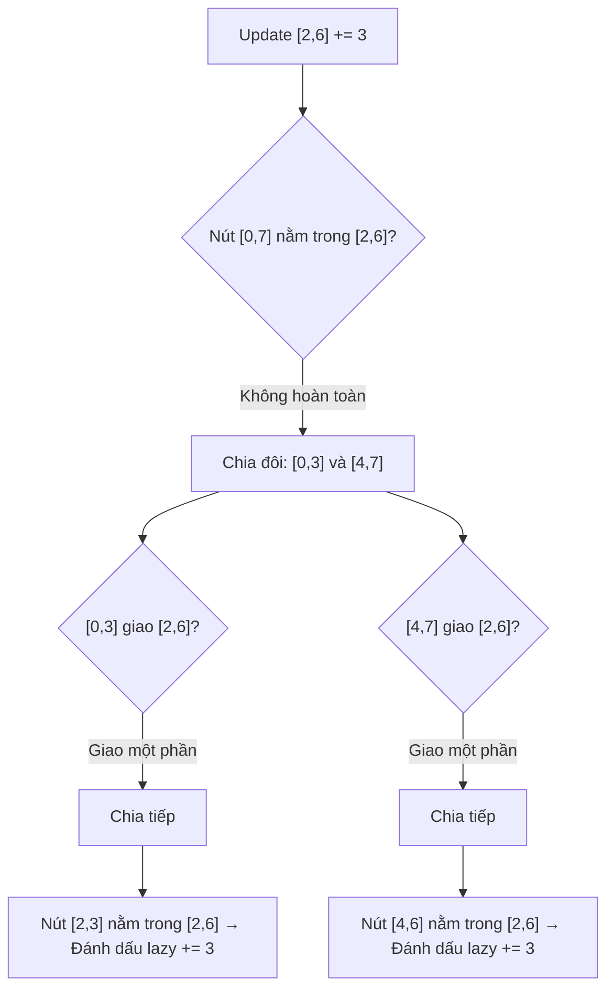

# Bài 22: Cải Tiến Segment Tree - Lazy Propagation & Merging

> **Tác giả:** FPTOJ Team<br>
> **Nội dung tham khảo từ:** VNOI Wiki, CP-Algorithms - Segment Tree

---

## 1. Bản chất vấn đề

### Bài toán: Cập nhật đoạn và truy vấn đoạn

Cho mảng $A$ gồm $N$ phần tử, thực hiện $Q$ truy vấn:

- **Update range:** Cộng $val$ vào tất cả phần tử trong đoạn $[l, r]$.
- **Query range:** Tìm tổng / min / max trong đoạn $[l, r]$.

**Segment Tree thường** chỉ hỗ trợ update 1 phần tử $O(\log N)$. Update đoạn bằng cách gọi update từng phần tử $\Rightarrow O(N \log N)$ mỗi truy vấn $\Rightarrow$ **quá chậm!**

**Lazy Propagation:** Đánh dấu "lười" (lazy), chỉ lan truyền khi cần $\Rightarrow O(\log N)$ mỗi truy vấn.

---

## 2. Tư duy cốt lõi

### Lazy Propagation — Ý tưởng

Khi cập nhật đoạn $[l, r]$, thay vì lan giá trị xuống tất cả lá:

1. Đánh dấu nút quản lý toàn bộ $[l, r]$ là "lazy" (chưa lan).
2. Chỉ lan (push down) khi cần truy vấn con của nút đó.

### Minh họa luồng



### Trace chi tiết

**Mảng:** $A = [1, 2, 3, 4, 5, 6, 7, 8]$, $N = 8$

**Cây Segment Tree ban đầu (tổng):**

| Nút | Đoạn | Tổng |
|-----|------|------|
| $[0,7]$ | $[1,2,3,4,5,6,7,8]$ | $36$ |
| $[0,3]$ | $[1,2,3,4]$ | $10$ |
| $[4,7]$ | $[5,6,7,8]$ | $26$ |

**Update: Cộng 3 vào đoạn $[2, 6]$:**

| Bước | Nút | Thao tác | lazy | sum mới |
|------|-----|----------|------|---------|
| 1 | $[0,7]$ | Giao một phần → chia đôi | 0 | 36 |
| 2 | $[0,3]$ | Giao một phần → chia | 0 | 10 |
| 3 | $[2,3]$ | Nằm gọn trong $[2,6]$ → lazy += 3, dừng (không xuống lá) | 3 | $7 + 3 \times 2 = 13$ |
| 4 | $[4,7]$ | Giao một phần → chia | 0 | 26 |
| 5 | $[4,5]$ | Nằm gọn trong $[2,6]$ → lazy += 3, dừng | 3 | $11 + 3 \times 2 = 17$ |
| 6 | $[6,7]$ | Giao một phần → chia | 0 | 15 |
| 7 | $[6,6]$ | Nằm gọn trong $[2,6]$ → lazy += 3, dừng | 3 | $7 + 3 = 10$ |
| 8 | $[7,7]$ | Không giao → giữ nguyên | 0 | 8 |
| 9 | Cập nhật $[6,7]$ sum | | | $10 + 8 = 18$ |
| 10 | Cập nhật $[4,7]$ sum | | | $17 + 18 = 35$ |
| 11 | Cập nhật $[0,7]$ sum | | | $13 + 35 = 48$ |

!!! tip "Điểm mấu chốt của lazy"
    Khi đoạn của nút **nằm gọn** trong đoạn update (như $[2,3] \subset [2,6]$), ta chỉ cộng lazy và cập nhật `sum`, **không đi xuống lá**. Đó là lý do update chỉ tốn $O(\log N)$ thay vì $O(N)$.

**Kết quả:** Tổng toàn mảng = $48 = 36 + 3 \times 4$ (4 phần tử trong $[2,6]$ được cộng 3).

---

## 3. Phân tích tính đúng đắn

### Tại sao Lazy Propagation đúng?

**Bất biến (Invariant):** Giá trị `sum[node]` luôn đúng cho đoạn mà node quản lý, **bao gồm cả giá trị lazy chưa lan**.

Khi cần truy vấn con:

1. **Push down:** Lan giá trị lazy từ node xuống 2 con.
2. Reset lazy của node về 0.
3. Tiếp tục đệ quy.

Đảm bảo: Trước khi truy vấn bất kỳ nút nào, tất cả tổ tiên lazy đã được push down.

---

## 4. Đánh giá độ phức tạp

| Thao tác | Thời gian | Không gian |
|----------|-----------|------------|
| Xây cây | $O(N)$ | $O(N)$ |
| Update đoạn | $O(\log N)$ | $O(1)$ |
| Query đoạn | $O(\log N)$ | $O(1)$ |
| **Tổng cho $Q$ truy vấn** | $O((N + Q) \log N)$ | $O(N)$ |

---

## Code minh họa

### Segment Tree với Lazy Propagation — Update đoạn, Query tổng

=== "C++"

    ```cpp
    #include <bits/stdc++.h>
    using namespace std;

    int n;
    vector<long long> tree, lazy;  // cây phân đoạn và mảng lazy

    void push(int node, int lo, int hi) {
        if (lazy[node] != 0) {
            tree[node] += lazy[node] * (hi - lo + 1);  // cập nhật node
            if (lo != hi) {                    // lan xuống hai con
                lazy[2 * node] += lazy[node];
                lazy[2 * node + 1] += lazy[node];
            }
            lazy[node] = 0;                    // reset lazy
        }
    }

    void update(int node, int lo, int hi, int l, int r, long long val) {
        push(node, lo, hi);                    // lan lazy trước
        if (r < lo || hi < l) return;          // ngoài đoạn
        if (l <= lo && hi <= r) {              // nằm hoàn toàn trong đoạn
            lazy[node] += val;
            push(node, lo, hi);
            return;
        }
        int mid = (lo + hi) / 2;
        update(2 * node, lo, mid, l, r, val);
        update(2 * node + 1, mid + 1, hi, l, r, val);
        tree[node] = tree[2 * node] + tree[2 * node + 1];  // tổng hợp
    }

    void build(const vector<long long>& a, int node, int lo, int hi) {
        if (lo == hi) {
            tree[node] = a[lo];
            return;
        }
        int mid = (lo + hi) / 2;
        build(a, 2 * node, lo, mid);
        build(a, 2 * node + 1, mid + 1, hi);
        tree[node] = tree[2 * node] + tree[2 * node + 1];
    }

    long long query(int node, int lo, int hi, int l, int r) {
        push(node, lo, hi);                    // lan lazy trước
        if (r < lo || hi < l) return 0;        // ngoài đoạn
        if (l <= lo && hi <= r) return tree[node];  // nằm hoàn toàn
        int mid = (lo + hi) / 2;
        return query(2 * node, lo, mid, l, r) +
               query(2 * node + 1, mid + 1, hi, l, r);
    }

    int main() {
        ios_base::sync_with_stdio(false);
        cin.tie(NULL);

        cin >> n;
        tree.assign(4 * n, 0);
        lazy.assign(4 * n, 0);

        vector<long long> a(n);
        for (int i = 0; i < n; i++) cin >> a[i];
        if (n > 0) build(a, 1, 0, n - 1);  // xây cây trong O(N)

        int q;
        cin >> q;
        while (q--) {
            int type;
            cin >> type;
            if (type == 1) {
                int l, r;
                long long val;
                cin >> l >> r >> val;
                l--; r--;
                update(1, 0, n - 1, l, r, val);  // cập nhật đoạn
            } else {
                int l, r;
                cin >> l >> r;
                l--; r--;
                cout << query(1, 0, n - 1, l, r) << "\n";  // truy vấn tổng đoạn
            }
        }
        return 0;
    }
    ```

=== "Python"

    ```python
    import sys
    input = sys.stdin.readline
    sys.setrecursionlimit(1 << 25)

    n = int(input())
    tree = [0] * (4 * n)   # cây phân đoạn
    lazy = [0] * (4 * n)   # mảng lazy

    def push(node, lo, hi):
        if lazy[node] != 0:
            tree[node] += lazy[node] * (hi - lo + 1)  # cập nhật node
            if lo != hi:                               # lan xuống hai con
                lazy[2 * node] += lazy[node]
                lazy[2 * node + 1] += lazy[node]
            lazy[node] = 0                             # reset lazy

    def update(node, lo, hi, l, r, val):
        push(node, lo, hi)            # lan lazy trước
        if r < lo or hi < l:          # ngoài đoạn
            return
        if l <= lo and hi <= r:       # nằm hoàn toàn trong đoạn
            lazy[node] += val
            push(node, lo, hi)
            return
        mid = (lo + hi) // 2
        update(2 * node, lo, mid, l, r, val)
        update(2 * node + 1, mid + 1, hi, l, r, val)
        tree[node] = tree[2 * node] + tree[2 * node + 1]  # tổng hợp

    def query(node, lo, hi, l, r):
        push(node, lo, hi)            # lan lazy trước
        if r < lo or hi < l:          # ngoài đoạn
            return 0
        if l <= lo and hi <= r:       # nằm hoàn toàn
            return tree[node]
        mid = (lo + hi) // 2
        return query(2 * node, lo, mid, l, r) + query(2 * node + 1, mid + 1, hi, l, r)

    a = list(map(int, input().split()))
    for i in range(n):
        update(1, 0, n - 1, i, i, a[i])  # xây cây

    q = int(input())
    for _ in range(q):
        parts = list(map(int, input().split()))
        if parts[0] == 1:
            l, r, val = parts[1] - 1, parts[2] - 1, parts[3]
            update(1, 0, n - 1, l, r, val)  # cập nhật đoạn
        else:
            l, r = parts[1] - 1, parts[2] - 1
            print(query(1, 0, n - 1, l, r))  # truy vấn tổng đoạn
    ```

### Dynamic Segment Tree, Segment Tree Merging và Segment Tree Beats

Bên cạnh Lazy Propagation trên mảng tĩnh kích thước $4N$, trong thi đấu ICPC / HSG Quốc gia còn 3 cải tiến rất thường gặp của Segment Tree:

1. **Dynamic (Sparse) Segment Tree:** Khi chỉ số trải dài tới $10^9$ (không thể khai báo mảng $4 \cdot 10^9$ phần tử) và truy vấn mang tính online không nén tọa độ trước được, ta chỉ tạo nút khi thật sự đi qua đường đi đó. Mỗi thao tác tạo tối đa $O(\log C)$ nút, bộ nhớ tổng là $O(Q \log C)$.
2. **Segment Tree Merging:** Dùng khi mỗi đỉnh $u$ trên cây có một Segment Tree lưu phân bố giá trị trong cây con của $u$, cần gộp cây con $v$ vào cây cha $u$. Ta đệ quy song song hai con trỏ `(u, v)`: nếu một nút rỗng thì trả về nút kia; nếu trùng lá thì cộng giá trị; còn lại đệ quy trái/phải rồi tổng hợp lại. Nhờ mỗi lá chỉ bị gộp khi cùng tồn tại ở cả hai cây, tổng số thao tác trên toàn bộ quá trình duyệt cây DFS chỉ là $O((N + Q) \log C)$.
3. **Segment Tree Beats (Ji Driver Segment Tree):** Xử lý các phép cập nhật không tuyến tính như gán $A[i] \leftarrow \min(A[i], x)$ trên đoạn $[l, r]$ và hỏi tổng đoạn. Mỗi nút duy trì 3 đại lượng: **giá trị lớn nhất** `mx1`, **số lần xuất hiện của `mx1`** là `cnt`, và **giá trị lớn thứ nhì nghiêm ngặt** `mx2`:
   - Nếu `mx1 <= x`: không phần tử nào trong đoạn bị giảm $\Rightarrow$ dừng ngay (`break condition`).
   - Nếu `mx2 < x < mx1`: chỉ các phần tử bằng `mx1` bị giảm xuống `x`, nên ta cập nhật trực tiếp `sum -= cnt * (mx1 - x)`, đặt `mx1 = x`, đánh dấu lazy và dừng (`tag condition`)!
   - Nếu `x <= mx2`: đệ quy tiếp xuống 2 con. Nhờ hàm thế năng đếm số giá trị phân biệt giảm dần, tổng độ phức tạp đạt $O((N + Q) \log N)$ (hoặc $O(Q \log^2 N)$ khi trộn thêm cộng đoạn).

=== "C++"

    ```cpp
    // 1. Dynamic Segment Tree + Segment Tree Merging (truy vấn tần suất / tổng đoạn thưa)
    struct DynNode {
        int left = 0, right = 0;
        long long sum = 0;
    };
    vector<DynNode> seg(1); // seg[0] là nút rỗng (null)

    int newNode() {
        seg.push_back(DynNode());
        return (int)seg.size() - 1;
    }

    void dynUpdate(int& id, long long lo, long long hi, long long pos, long long delta) {
        if (!id) id = newNode();
        seg[id].sum += delta;
        if (lo == hi) return;
        long long mid = lo + (hi - lo) / 2;
        if (pos <= mid) dynUpdate(seg[id].left, lo, mid, pos, delta);
        else dynUpdate(seg[id].right, mid + 1, hi, pos, delta);
    }

    // Gộp cây b vào cây a theo kiểu hủy b (chỉ tốn bộ nhớ O(Q log C))
    int mergeTree(int a, int b, long long lo, long long hi) {
        if (!a || !b) return a | b;
        if (lo == hi) {
            seg[a].sum += seg[b].sum;
            return a;
        }
        long long mid = lo + (hi - lo) / 2;
        seg[a].left = mergeTree(seg[a].left, seg[b].left, lo, mid);
        seg[a].right = mergeTree(seg[a].right, seg[b].right, mid + 1, hi);
        seg[a].sum = seg[seg[a].left].sum + seg[seg[a].right].sum;
        return a;
    }

    // 2. Segment Tree Beats: cập nhật a[i] = min(a[i], x) trên [l, r] và hỏi tổng
    struct BeatsTree {
        struct Node { long long sum, mx1, mx2; int cnt; };
        int n;
        vector<Node> st;
        static constexpr long long NEG_INF = -4e18;

        BeatsTree(const vector<long long>& a) : n((int)a.size()), st(4 * n) {
            if (n > 0) build(a, 1, 0, n - 1);
        }

        void pull(int id) {
            auto &L = st[2 * id], &R = st[2 * id + 1];
            st[id].sum = L.sum + R.sum;
            if (L.mx1 == R.mx1) {
                st[id].mx1 = L.mx1;
                st[id].cnt = L.cnt + R.cnt;
                st[id].mx2 = max(L.mx2, R.mx2);
            } else if (L.mx1 > R.mx1) {
                st[id].mx1 = L.mx1;
                st[id].cnt = L.cnt;
                st[id].mx2 = max(L.mx2, R.mx1);
            } else {
                st[id].mx1 = R.mx1;
                st[id].cnt = R.cnt;
                st[id].mx2 = max(L.mx1, R.mx2);
            }
        }

        void applyChmin(int id, long long x) {
            if (x >= st[id].mx1) return;
            st[id].sum -= 1LL * st[id].cnt * (st[id].mx1 - x);
            st[id].mx1 = x;
        }

        void push(int id) {
            applyChmin(2 * id, st[id].mx1);
            applyChmin(2 * id + 1, st[id].mx1);
        }

        void build(const vector<long long>& a, int id, int lo, int hi) {
            if (lo == hi) {
                st[id] = {a[lo], a[lo], NEG_INF, 1};
                return;
            }
            int mid = (lo + hi) / 2;
            build(a, 2 * id, lo, mid);
            build(a, 2 * id + 1, mid + 1, hi);
            pull(id);
        }

        void rangeChmin(int id, int lo, int hi, int l, int r, long long x) {
            if (r < lo || hi < l || st[id].mx1 <= x) return; // break condition
            if (l <= lo && hi <= r && st[id].mx2 < x) {       // tag condition
                applyChmin(id, x);
                return;
            }
            push(id);
            int mid = (lo + hi) / 2;
            rangeChmin(2 * id, lo, mid, l, r, x);
            rangeChmin(2 * id + 1, mid + 1, hi, l, r, x);
            pull(id);
        }

        long long rangeSum(int id, int lo, int hi, int l, int r) {
            if (r < lo || hi < l) return 0;
            if (l <= lo && hi <= r) return st[id].sum;
            push(id);
            int mid = (lo + hi) / 2;
            return rangeSum(2 * id, lo, mid, l, r) + rangeSum(2 * id + 1, mid + 1, hi, l, r);
        }
    };
    ```

=== "Python"

    ```python
    class DynNode:
        __slots__ = ('left', 'right', 'sum')
        def __init__(self):
            self.left = None
            self.right = None
            self.sum = 0

    def dyn_update(node, lo, hi, pos, delta):
        if node is None:
            node = DynNode()
        node.sum += delta
        if lo == hi:
            return node
        mid = (lo + hi) // 2
        if pos <= mid:
            node.left = dyn_update(node.left, lo, mid, pos, delta)
        else:
            node.right = dyn_update(node.right, mid + 1, hi, pos, delta)
        return node

    def merge_tree(a, b, lo, hi):
        """Gộp Dynamic Segment Tree b vào a trong O(log C) amortized."""
        if a is None:
            return b
        if b is None:
            return a
        if lo == hi:
            a.sum += b.sum
            return a
        mid = (lo + hi) // 2
        a.left = merge_tree(a.left, b.left, lo, mid)
        a.right = merge_tree(a.right, b.right, mid + 1, hi)
        a.sum = (a.left.sum if a.left else 0) + (a.right.sum if a.right else 0)
        return a
    ```

---

## 5. Lỗi thường gặp (SAI / ĐÚNG)

### SAI 1: Quên `push` trước khi query / update → đọc giá trị cũ

```cpp
// SAI: không lan lazy, tree[node] của con chưa được cập nhật
long long query(int node, int lo, int hi, int l, int r) {
    if (r < lo || hi < l) return 0;
    ...
}
```

```cpp
// ĐÚNG: dòng đầu tiên của update/query LUÔN là push
long long query(int node, int lo, int hi, int l, int r) {
    push(node, lo, hi); // lan lazy của cha xuống trước khi đi tiếp
    if (r < lo || hi < l) return 0;
    ...
}
```

| Vị trí quên `push` | Hậu quả |
|---|---|
| Đầu `update` | Cộng dồn sai vì con chưa nhận lazy cũ của cha |
| Đầu `query` | Trả về tổng cũ, thiếu phần lazy chưa lan |

### SAI 2: Build cây bằng $N$ lần update-điểm → $O(N \log N)$ chậm

```cpp
// LƯU Ý: nếu không dùng build O(N) như Code minh họa ở trên mà gọi update điểm N lần
// thì khởi tạo cây tốn O(N log N) thay vì O(N). Cách tối ưu là build đệ quy một lần:
for (int i = 0; i < n; i++) update(1, 0, n - 1, i, i, a[i]); // chậm hơn build()
```

```cpp
// ĐÚNG: build đệ quy O(N) — lá = a[lo], nút trong = tổng 2 con
void build(int node, int lo, int hi) {
    if (lo == hi) { tree[node] = a[lo]; return; } // lá: giá trị mảng
    int mid = (lo + hi) / 2;
    build(2 * node, lo, mid);          // xây cây con trái
    build(2 * node + 1, mid + 1, hi);  // xây cây con phải
    tree[node] = tree[2 * node] + tree[2 * node + 1]; // tổng hợp
}
```

### SAI 3: Nhầm `lo/hi` (đoạn nút quản lý) với `l/r` (đoạn truy vấn)

```cpp
// SAI: đảo điều kiện → nhánh cắt sai, kết quả sai
if (lo <= l && r <= hi) return tree[node];
if (l < lo || hi < r) return;
```

```cpp
// ĐÚNG: đọc theo thứ tự "nút [lo,hi] so với truy vấn [l,r]"
if (r < lo || hi < l) return;          // ngoài đoạn: không giao nhau
if (l <= lo && hi <= r) return tree[node]; // nằm gọn: lấy luôn
```

> **Mẹo nhớ:** `lo/hi` đi với `node` (đoạn của nút), `l/r` đi với `val`/truy vấn. Điều kiện "nằm gọn" luôn là `l <= lo && hi <= r` (truy vấn bao trùm nút).

---

## 6. Bài tập luyện tập

| Mã bài | Tên bài tập | Độ khó | Kiểu bài tập (Bản chất) |
|---|---|---|---|
| [`st-range-mul-add`](https://fptoj.com/problem/st-range-mul-add) | Cộng Nhân Đoạn Tính Tổng | ⭐⭐⭐ | Quản lý đồng thời 2 nhãn lười (cộng & nhân) |
| [`st-dynamic`](https://fptoj.com/problem/st-dynamic) | Cây Phân Đoạn Động | ⭐⭐⭐ | Dynamic Segment Tree (cấp phát động) |
| [`st-tree-path`](https://fptoj.com/problem/st-tree-path) | Cập Nhật Đường Đi Trên Cây | ⭐⭐⭐⭐ | Phân rã cây Heavy-Light Decomposition (HLD) |
| [`st-sweepline-area`](https://fptoj.com/problem/st-sweepline-area) | Hợp Diện Tích Hình Chữ Nhật | ⭐⭐⭐⭐ | Thuật toán Sweep Line quét đĩa |
| [`st-2d-basic`](https://fptoj.com/problem/st-2d-basic) | Cập Nhật Điểm Tổng Ma Trận Con | ⭐⭐⭐⭐ | 2D Segment Tree (Cây lồng cây 2 chiều) |
| [`st-persistent-sum`](https://fptoj.com/problem/st-persistent-sum) | Tổng Đoạn Trên Lịch Sử | ⭐⭐⭐⭐ | Cây phân đoạn bền vững (Persistent Segment Tree) |
| [`st-merge`](https://fptoj.com/problem/st-merge) | Tần Suất Màu Sắc Cây Con | ⭐⭐⭐⭐ | Gộp cây phân đoạn (Segment Tree Merging) |
| [`st-range-chmin`](https://fptoj.com/problem/st-range-chmin) | Chmin Đoạn Và Tính Tổng | ⭐⭐⭐⭐⭐ | Segment Tree Beats (Cập nhật min đoạn nâng cao) |

---

## 7. Tài liệu tham khảo

*   [CP-Algorithms - Segment Tree Beats](https://cp-algorithms.com/data_structures/segment_tree.html#segment-tree-beats)
*   [VNOI Wiki - Heavy-Light Decomposition](https://wiki.vnoi.info/algo/data-structures/heavy-light-decomposition)
*   [VNOI Wiki - Persistent Segment Tree](https://wiki.vnoi.info/algo/data-structures/persistent-segment-tree)
*   [Codeforces - Segment Tree Merging](https://codeforces.com/blog/entry/19004)

---

**Bài trước:** [← Bài 21: Segment Tree (Cây Phân Đoạn)](segment-tree.md) | **Bài tiếp theo:** [Bài 23: Fenwick Tree (BIT) →](fenwick-tree.md)
