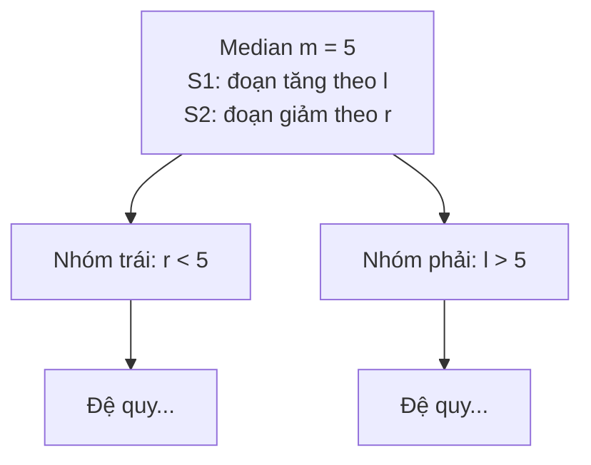

# Bài 30: Interval Tree Trên Tập Đoạn Thẳng - Truy Vấn Giao Đoạn

> **Tác giả:** FPTOJ Team<br>
> **Nội dung tham khảo từ:** CP-Algorithms - Interval Tree

---

## 1. Bản chất vấn đề

### Bài toán: Tìm đoạn thẳng giao với đoạn truy vấn

Cho $N$ đoạn thẳng $[l_i, r_i]$ trên trục số. Thực hiện $Q$ truy vấn: với đoạn $[a, b]$, liệt kê tất cả đoạn trong tập đã cho giao với $[a, b]$.

**Hai đoạn giao nhau** khi $[l_i, r_i] \cap [a, b] \neq \emptyset$, tức $\max(l_i, a) \le \min(r_i, b)$.

**Cách thường:** Duyệt $N$ đoạn $\Rightarrow O(N)$ mỗi truy vấn $\Rightarrow O(NQ)$.

**Interval Tree:** Truy vấn $O(\log N + k)$ với $k$ là số đoạn giao.

---

## 2. Tư duy cốt lõi

### Ý tưởng: Sắp xếp theo median

1. Tìm median $m$ của tất cả điểm đầu $l_i$.
2. Chia đoạn thành 3 nhóm:
   - **Trái:** $r_i < m$ (toàn bộ nằm bên trái median)
   - **Phải:** $l_i > m$ (toàn bộ nằm bên phải median)
   - **Giao:** $l_i \le m \le r_i$ (chứa median)

3. Nhóm "Giao" sắp xếp thành 2 mảng:
   - $S_1$: tăng dần theo $l_i$
   - $S_2$: giảm dần theo $r_i$

4. Đệ quy xây cây cho nhóm Trái và Phải.

### Cấu trúc cây



### Truy vấn: Tìm đoạn giao với $[a, b]$

| Trường hợp | Điều kiện | Kết quả |
|------------|-----------|---------|
| $b < m$ | Đoạn truy vấn nằm trái | Tìm trong S1: đoạn nào $l_i \le b$ |
| $a > m$ | Đoạn truy vấn nằm phải | Tìm trong S2: đoạn nào $r_i \ge a$ |
| $a \le m \le b$ | Chứa median | Tất cả đoạn trong S1 và S2 đều giao |

---

## 3. Phân tích tính đúng đắn

### Tại sao S1 và S2 tối ưu?

**S1** (tăng theo $l_i$): Khi $b < m$, đoạn truy vấn $[a, b]$ chỉ giao với đoạn có $l_i \le b$ (vì $r_i \ge m > b$ không cần xét). Do S1 tăng dần, chỉ cần lấy prefix có $l_i \le b$ $\Rightarrow$ binary search.

**S2** (giảm theo $r_i$): Khi $a > m$, chỉ cần đoạn có $r_i \ge a$. Do S2 giảm dần, binary search.

---

## 4. Đánh giá độ phức tạp

| Thao tác | Thời gian | Không gian |
|----------|-----------|------------|
| Xây cây | $O(N \log N)$ | $O(N \log N)$ |
| Truy vấn 1 đoạn | $O(\log N + k)$ | $O(1)$ |

$k$ = số đoạn giao được tìm thấy. Lưu ý rằng ở mỗi nút ta chỉ duyệt các đoạn thực sự giao ($l_i \le b$ hoặc $r_i \ge a$) và dùng binary search (hoặc quét từ đầu mảng đã sắp xếp và dừng ngay khi không thỏa mãn) — tổng số phần tử duyệt qua trên các nút đúng bằng $k$, nên tổng thời gian truy vấn là $O(\log N + k)$ (với đếm số lượng giao điểm không cần liệt kê thì chỉ mất $O(\log N)$ nhờ `upper_bound` / `bisect`).

---

## Code minh họa

=== "C++"

    ```cpp
    #include <bits/stdc++.h>
    using namespace std;

    struct IntervalTree {
        struct Node {
            int median;
            vector<pair<int,int>> S1; // tăng dần theo l
            vector<pair<int,int>> S2; // giảm dần theo r
            int left = -1, right = -1;
        };

        vector<Node> nodes;
        int root = -1;

        int build(vector<pair<int,int>>& intervals) {
            if (intervals.empty()) return -1;

            int id = nodes.size();
            nodes.emplace_back();

            // Tìm median của l_i
            vector<int> lvals;
            lvals.reserve(intervals.size());
            for (auto& [l, r] : intervals) lvals.push_back(l);
            nth_element(lvals.begin(), lvals.begin() + lvals.size() / 2, lvals.end());
            int med = lvals[lvals.size() / 2];
            nodes[id].median = med;

            vector<pair<int,int>> leftSet, rightSet;
            for (auto& [l, r] : intervals) {
                if (r < med) leftSet.push_back({l, r});
                else if (l > med) rightSet.push_back({l, r});
                else {
                    nodes[id].S1.push_back({l, r});
                    nodes[id].S2.push_back({l, r});
                }
            }

            sort(nodes[id].S1.begin(), nodes[id].S1.end());
            sort(nodes[id].S2.begin(), nodes[id].S2.end(), [](const auto& a, const auto& b) {
                return a.second > b.second;
            });

            int lChild = build(leftSet);
            int rChild = build(rightSet);
            nodes[id].left = lChild;
            nodes[id].right = rChild;
            return id;
        }

        IntervalTree(vector<pair<int,int>>& intervals) {
            root = build(intervals);
        }

        void query(int id, int a, int b, vector<pair<int,int>>& result) const {
            if (id == -1) return;
            const Node& node = nodes[id];

            if (b < node.median) {
                // Tìm tất cả đoạn trong S1 có l_i <= b bằng upper_bound
                auto endIt = upper_bound(node.S1.begin(), node.S1.end(), b,
                    [](int val, const pair<int,int>& seg) { return val < seg.first; });
                result.insert(result.end(), node.S1.begin(), endIt);
                query(node.left, a, b, result);
            } else if (a > node.median) {
                // Tìm tất cả đoạn trong S2 có r_i >= a (S2 giảm dần theo r)
                auto endIt = upper_bound(node.S2.begin(), node.S2.end(), a,
                    [](int val, const pair<int,int>& seg) { return val > seg.second; });
                result.insert(result.end(), node.S2.begin(), endIt);
                query(node.right, a, b, result);
            } else {
                // [a, b] chứa median → tất cả đoạn ở nút này đều giao
                result.insert(result.end(), node.S1.begin(), node.S1.end());
                query(node.left, a, b, result);
                query(node.right, a, b, result);
            }
        }
    };

    int main() {
        ios_base::sync_with_stdio(false);
        cin.tie(NULL);
        int n, q;
        cin >> n >> q;
        vector<pair<int,int>> intervals(n);
        for (int i = 0; i < n; i++)
            cin >> intervals[i].first >> intervals[i].second;

        IntervalTree tree(intervals);

        while (q--) {
            int a, b;
            cin >> a >> b;
            vector<pair<int,int>> result;
            tree.query(tree.root, a, b, result);
            cout << result.size() << "\n";
            for (auto& [l, r] : result)
                cout << l << " " << r << "\n";
        }
        return 0;
    }
    ```

=== "Python"

    ```python
    from bisect import bisect_right
    import sys
    input = sys.stdin.readline

    class IntervalTree:
        def __init__(self, intervals):
            self.root = self._build(intervals)

        def _build(self, intervals):
            if not intervals:
                return None
            lvals = sorted(l for l, r in intervals)
            median = lvals[len(lvals) // 2]

            left_set, right_set, mid_set = [], [], []
            for l, r in intervals:
                if r < median:
                    left_set.append((l, r))
                elif l > median:
                    right_set.append((l, r))
                else:
                    mid_set.append((l, r))

            s1 = sorted(mid_set)
            s2 = sorted(mid_set, key=lambda x: -x[1])
            return {
                'median': median,
                'S1': s1,
                'S1_l': [seg[0] for seg in s1],
                'S2': s2,
                'S2_neg_r': [-seg[1] for seg in s2],
                'left': self._build(left_set),
                'right': self._build(right_set)
            }

        def query(self, a, b):
            result = []
            self._query(self.root, a, b, result)
            return result

        def _query(self, node, a, b, result):
            if not node:
                return
            m = node['median']
            if b < m:
                cnt = bisect_right(node['S1_l'], b)
                result.extend(node['S1'][:cnt])
                self._query(node['left'], a, b, result)
            elif a > m:
                cnt = bisect_right(node['S2_neg_r'], -a)
                result.extend(node['S2'][:cnt])
                self._query(node['right'], a, b, result)
            else:
                result.extend(node['S1'])
                self._query(node['left'], a, b, result)
                self._query(node['right'], a, b, result)

    n, q = map(int, input().split())
    intervals = [tuple(map(int, input().split())) for _ in range(n)]
    tree = IntervalTree(intervals)

    for _ in range(q):
        a, b = map(int, input().split())
        result = tree.query(a, b)
        print(len(result))
        for l, r in result:
            print(l, r)
    ```

---

## 5. Lưu ý & Lỗi thường gặp

### Nhầm lẫn giữa Interval Tree và Segment Tree

| Tiêu chí | Segment Tree | Interval Tree (tập đoạn thẳng) |
|---|---|---|
| Đầu vào | Mảng $A[1..N]$ cố định | Tập $N$ đoạn $[l_i, r_i]$ bất kỳ |
| Truy vấn chính | Tổng / Min / Max trên $[L, R]$ | Liệt kê / Đếm các đoạn giao $[a, b]$ |
| Bộ nhớ | $O(4N)$ | $O(N \log N)$ |

### Chọn median chỉ theo $l_i$ khi có nhiều đoạn chung đầu mút

```cpp
// RỦI RO: Nếu mọi đoạn đều bắt đầu tại l = 0, chọn median theo l_i khiến cây bị suy biến.
// TỐT HƠN: Lấy trung vị trên hợp 2N đầu mút {l_i, r_i} (hoặc rời rạc hóa tọa độ + Segment Tree).
```

### Đọc nhầm thứ tự tìm kiếm nhị phân trên `S2`

```cpp
// SAI: S2 sắp xếp r giảm dần nhưng lại dùng lower_bound thông thường
// ĐÚNG: Dùng comparator custom hoặc lưu -r để tận dụng lower_bound / upper_bound chuẩn
// (Xem chi tiết cách dùng upper_bound với lambda giảm dần ở mục query C++ phía trên)
```

---

## 6. Bài tập luyện tập

| Mã bài | Tên bài tập | Độ khó | Kiểu bài tập (Bản chất) |
|---|---|---|---|
| [`it-any-intersect`](https://fptoj.com/problem/it-any-intersect) | Tồn Tại Đoạn Giao Nhau | ⭐ | Kiểm tra tồn tại giao điểm bằng Interval Tree |
| [`it-find-all`](https://fptoj.com/problem/it-find-all) | Liệt Kê Các Đoạn Giao Nhau | ⭐⭐ | Trả về danh sách và checksum các đoạn thẳng giao $[A, B]$ |
| [`it-count-intersect`](https://fptoj.com/problem/it-count-intersect) | Đếm Số Lượng Đoạn Giao Nhau | ⭐⭐ | Đếm số lượng đoạn giao bằng Binary Search |
| [`it-point-query`](https://fptoj.com/problem/it-point-query) | Truy Vấn Điểm Thuộc Đoạn | ⭐⭐ | Tìm các đoạn chứa điểm $X$ bằng Interval Tree |
| [`it-max-right-int`](https://fptoj.com/problem/it-max-right-int) | Đoạn Giao Có Mút Phải Lớn Nhất | ⭐⭐⭐ | RMQ tiền tố kết hợp Binary Search |
| [`it-min-len-int`](https://fptoj.com/problem/it-min-len-int) | Độ Dài Giao Nhỏ Nhất | ⭐⭐⭐⭐ | Xử lý offline kết hợp Segment Tree RMQ |
| [`it-largest-overlap`](https://fptoj.com/problem/it-largest-overlap) | Phần Giao Nhau Lớn Nhất | ⭐⭐⭐⭐ | Bài toán hình học quét tuyến tính tối ưu |
| [`it-superset-query`](https://fptoj.com/problem/it-superset-query) | Truy Vấn Bao Phủ Hoàn Toàn | ⭐⭐⭐⭐⭐ | Phép bao phủ 2D: Offline Sweep-line + Segment Tree |

---

**Bài liên quan:**

*   [Segment Tree](segment-tree.md)
*   [Static Wavelet Tree](wavelet-tree.md)

---

**Bài trước:** [← Bài 29: Static Wavelet Tree](wavelet-tree.md) | **Bài tiếp theo:** [Bài 31: BFS & DFS →](bfs-dfs-do-thi.md)
