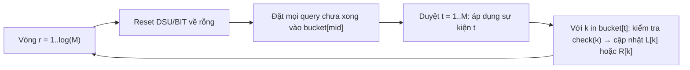

# Bài 102: Parallel Binary Search - Tìm Kiếm Nhị Phân Song Song

> **Tác giả:** FPTOJ Team<br>
> **Nội dung tham khảo từ:** Codeforces Blog, USACO Guide - Parallel Binary Search

---

## 1. Bản chất vấn đề

### Bài toán mở đầu (Meteors / Thời điểm liên thông)

Cho $N$ đỉnh và $M$ cạnh thêm vào lần lượt tại các thời điểm $1, 2, \dots, M$. Có $Q$ truy vấn, truy vấn thứ $k$ hỏi cặp $(u_k, v_k)$ bắt đầu liên thông với nhau từ **thời điểm sớm nhất** nào?

- **Chạy Binary Search riêng lẻ cho từng truy vấn:** Với mỗi truy vấn $k$, tìm kiếm nhị phân thời điểm $t \in [1, M]$ rồi dựng lại DSU từ $1 \dots t$ $\Rightarrow$ tốn $O(Q \cdot M \log M)$ $\Rightarrow$ **TLE chắc chắn** với $N, M, Q \le 10^5$.
- **Parallel Binary Search:** Chạy tìm kiếm nhị phân cho **tất cả $Q$ truy vấn cùng lúc** theo từng tầng độ sâu của cây tìm kiếm nhị phân. Tại mỗi tầng, ta chỉ quét mảng sự kiện $1 \dots M$ **duy nhất một lần** $\Rightarrow$ tổng thời gian giảm từ $O(Q M \log M)$ xuống **$O((M + Q) \log M \cdot \alpha(N))$**!

---

## 2. Tư duy cốt lõi

Hãy hình dung mỗi truy vấn $k$ có một khoảng tìm kiếm $[L_k, R_k]$ (ban đầu $[1, M+1]$). Ở một vòng lặp tổng quát:

1. Khởi tạo lại trạng thái cấu trúc dữ liệu về $0$ (rỗng).
2. Gom mọi truy vấn còn đang tìm ($L_k < R_k$) vào danh sách tại điểm giữa `mid = (L_k + R_k) / 2`: `bucket[mid].push_back(k)`.
3. Chạy vòng lặp `t` từ $1$ đến $M$:
   - Áp dụng sự kiện thứ `t` (ví dụ: nối cạnh `t` trong DSU, hoặc cộng giá trị trên Segment Tree/BIT).
   - Xử lý tất cả truy vấn nằm trong `bucket[t]`: kiểm tra điều kiện `check(k)` ngay trên trạng thái hiện tại!
     - Nếu thỏa mãn: cập nhật `ans[k] = t`, thu hẹp `R[k] = t - 1`.
     - Nếu chưa thỏa mãn: đẩy `L[k] = t + 1`.
4. Sau mỗi vòng, kích thước đoạn $[L_k, R_k]$ của **mọi truy vấn đều giảm đi một nửa** $\Rightarrow$ chỉ cần tối đa $\lceil \log_2 M \rceil + 1$ vòng lặp là tìm xong toàn bộ $Q$ truy vấn!



### So sánh với các kỹ thuật khác

| Kỹ thuật | Yêu cầu bài toán | Độ phức tạp | Ghi chú |
| :--- | :--- | :---: | :--- |
| Chạy BS từng truy vấn | Tính đơn điệu theo $t$ | $O(Q \cdot M \log M)$ | Quá chậm vì dựng lại trạng thái $Q \log M$ lần |
| Persistent Data Structure | Cấu trúc hỗ trợ persistent (như PST) | $O((M + Q) \log N)$ | Tốn thêm bộ nhớ $O(M \log N)$ |
| **Parallel Binary Search** | Chỉ cần thỏa tính đơn điệu; DSU / BIT thường đủ dùng | $O((M + Q) \log M)$ | Cực kỳ tiết kiệm bộ nhớ, áp dụng được cho DSU không persistent |

---

## 3. Phân tích tính đúng đắn & Độ phức tạp

- **Điều kiện áp dụng:** Trạng thái `check(k, t)` của mọi truy vấn phải **đơn điệu** theo thời gian $t$ (nếu đúng tại $t_0$ thì đúng với mọi $t \ge t_0$).
- **Độ phức tạp:**
  - Số vòng lặp tối đa: $\lceil \log_2(M + 1) \rceil$.
  - Mỗi vòng duyệt qua đúng $M$ sự kiện và mỗi truy vấn được kiểm tra đúng $1$ lần.
  - Tổng thời gian: **$O((M \cdot T_{\text{update}} + Q \cdot T_{\text{query}}) \log M)$**, với $T_{\text{update}}, T_{\text{query}}$ thường là $O(\alpha(N))$ (DSU) hoặc $O(\log N)$ (BIT/SegTree).

---

## Code minh họa

### Tìm thời điểm sớm nhất hai đỉnh $(u_k, v_k)$ liên thông trên cây/đồ thị động

=== "C++"

    ```cpp
    #include <bits/stdc++.h>
    using namespace std;

    struct DSU {
        vector<int> p, sz;
        DSU(int n) { reset(n); }
        void reset(int n) {
            p.resize(n + 1);
            sz.assign(n + 1, 1);
            iota(p.begin(), p.end(), 0);
        }
        int find(int x) { return p[x] == x ? x : p[x] = find(p[x]); }
        void unite(int a, int b) {
            a = find(a); b = find(b);
            if (a == b) return;
            if (sz[a] < sz[b]) swap(a, b);
            p[b] = a; sz[a] += sz[b];
        }
        bool same(int a, int b) { return find(a) == find(b); }
    };

    int main() {
        ios_base::sync_with_stdio(false);
        cin.tie(nullptr);

        int n, m, q;
        cin >> n >> m >> q;
        vector<pair<int, int>> edges(m + 1);
        for (int i = 1; i <= m; i++) {
            cin >> edges[i].first >> edges[i].second;
        }
        vector<pair<int, int>> queries(q);
        for (int i = 0; i < q; i++) {
            cin >> queries[i].first >> queries[i].second;
        }

        vector<int> lo(q, 1), hi(q, m), ans(q, -1);
        // Trường hợp u == v liên thông ngay tại thời điểm 0
        for (int i = 0; i < q; i++) {
            if (queries[i].first == queries[i].second) {
                ans[i] = 0;
                hi[i] = 0;
            }
        }

        DSU dsu(n);
        vector<vector<int>> bucket(m + 1);

        // Chạy tối đa ceil(log2(m)) + 1 vòng tìm kiếm song song
        while (true) {
            bool changed = false;
            for (int t = 1; t <= m; t++) bucket[t].clear();
            for (int i = 0; i < q; i++) {
                if (lo[i] <= hi[i]) {
                    int mid = lo[i] + (hi[i] - lo[i]) / 2;
                    bucket[mid].push_back(i);
                    changed = true;
                }
            }
            if (!changed) break;

            dsu.reset(n);
            for (int t = 1; t <= m; t++) {
                dsu.unite(edges[t].first, edges[t].second);
                for (int idx : bucket[t]) {
                    if (dsu.same(queries[idx].first, queries[idx].second)) {
                        ans[idx] = t;
                        hi[idx] = t - 1;
                    } else {
                        lo[idx] = t + 1;
                    }
                }
            }
        }

        for (int i = 0; i < q; i++) {
            cout << ans[i] << "\n";
        }
        return 0;
    }
    ```

=== "Python"

    ```python
    import sys
    input = sys.stdin.readline

    class DSU:
        def __init__(self, n):
            self.n = n
            self.reset()

        def reset(self):
            self.p = list(range(self.n + 1))
            self.sz = [1] * (self.n + 1)

        def find(self, x):
            while self.p[x] != x:
                self.p[x] = self.p[self.p[x]]
                x = self.p[x]
            return x

        def unite(self, a, b):
            a, b = self.find(a), self.find(b)
            if a != b:
                if self.sz[a] < self.sz[b]:
                    a, b = b, a
                self.p[b] = a
                self.sz[a] += self.sz[b]

    def solve():
        n, m, q = map(int, input().split())
        edges = [(0, 0)] + [tuple(map(int, input().split())) for _ in range(m)]
        queries = [tuple(map(int, input().split())) for _ in range(q)]

        lo = [1] * q
        hi = [m] * q
        ans = [-1] * q
        for i, (u, v) in enumerate(queries):
            if u == v:
                ans[i] = 0
                hi[i] = 0

        dsu = DSU(n)
        while True:
            buckets = [[] for _ in range(m + 1)]
            any_left = False
            for i in range(q):
                if lo[i] <= hi[i]:
                    mid = (lo[i] + hi[i]) // 2
                    buckets[mid].append(i)
                    any_left = True
            if not any_left:
                break

            dsu.reset()
            for t in range(1, m + 1):
                u, v = edges[t]
                dsu.unite(u, v)
                for idx in buckets[t]:
                    qu, qv = queries[idx]
                    if dsu.find(qu) == dsu.find(qv):
                        ans[idx] = t
                        hi[idx] = t - 1
                    else:
                        lo[idx] = t + 1

        print("\n".join(map(str, ans)))

    if __name__ == "__main__":
        solve()
    ```

---

## 4. Lỗi thường gặp (SAI / ĐÚNG)

- **Quên reset cấu trúc dữ liệu đầu mỗi vòng:** Nếu không gọi `dsu.reset(n)` (hoặc `fill(bit, 0)`) trước vòng lặp `t = 1..M`, trạng thái từ vòng trước bị giữ nguyên khiến mọi truy vấn sai hoàn toàn.
- **Không xử lý trường hợp $t = 0$ hoặc vô nghiệm:** Khi $u = v$ ngay từ đầu (hoặc điều kiện thỏa ở thời điểm 0 trước mọi sự kiện), cần xử lý trước khi vào vòng lặp tìm kiếm trong `[1, M]`.
- **Dùng `vector<vector<int>>` cấp phát lại nhiều lần trong vòng `while`:** Để tiết kiệm bộ nhớ/thời gian, khai báo `bucket` kích thước $M+1$ ngoài vòng `while` rồi `.clear()` từng phần tử sau mỗi vòng (hoặc dùng danh sách liên kết chỉ số).

---

## 5. Bài tập luyện tập

| Bài toán | Nền tảng | Độ khó | Ý tưởng |
| :--- | :--- | :---: | :--- |
| [SPOJ - METEORS](https://www.spoj.com/problems/METEORS/) | SPOJ | ⭐⭐⭐⭐ | Bài kinh điển: Fenwick Tree + Parallel Binary Search |
| [AtCoder AGC002 D - Stamp Rally](https://atcoder.jp/contests/agc002/tasks/agc002_d) | AtCoder | ⭐⭐⭐⭐ | DSU đếm số đỉnh đã thăm + Parallel Binary Search |
| [CSES - New Roads Queries](https://cses.fi/problemset/task/2101) | CSES | ⭐⭐⭐ | Có thể giải bằng Parallel BS + DSU hoặc Kruskal Reconstruction Tree |

---

**Bài trước:** [← Bài 101: Treap & PBDS](treap-pbds.md) | **Bài tiếp theo:** [Bài 103: Convex Hull Trick & Li Chao Tree →](convex-hull-trick.md)
