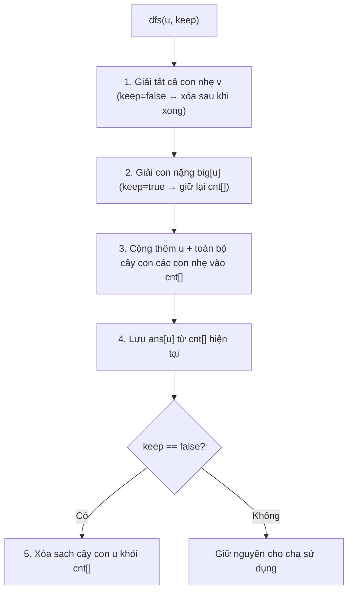

# Bài 89: Small-to-Large (DSU on Tree / Sack)

> **Tác giả:** FPTOJ Team<br>
> **Nội dung tham khảo từ:** Codeforces Blog (Arpa - Sack), CP-Algorithms, VNOI Wiki

---

## 1. Bản chất vấn đề

### Bài toán: Đếm thống kê trên mọi cây con

Cho một cây có $N$ đỉnh gốc tại đỉnh $1$, mỗi đỉnh $u$ có màu $c[u]$ ($1 \le c[u] \le N$). Với **mọi đỉnh $u$**, hãy đếm xem trong cây con gốc $u$ có bao nhiêu **màu khác nhau** (hoặc màu xuất hiện nhiều nhất, tổng giá trị các đỉnh có tần suất thỏa điều kiện, v.v.).

- **Cách ngây thơ:** Với mỗi đỉnh $u$, duyệt lại toàn bộ cây con của $u$ $\Rightarrow O(N^2)$ (chậm khi $N \le 2 \cdot 10^5$).
- **Cách dùng cấu trúc gộp mảng/map:** Tại mỗi đỉnh $u$, tạo một `map`/`set` rồi gộp kết quả từ các con $v$ vào cha $u$. Nếu gộp tùy ý (đổ `map` lớn vào `map` nhỏ), tổng độ phức tạp vẫn có thể đạt $O(N^2)$ khi cây suy biến.
- **Small-to-Large (DSU on Tree):** Luôn giữ lại cấu trúc dữ liệu của **con nặng nhất** (con có kích thước cây con lớn nhất) và chỉ duyệt/chép các **con nhẹ** vào đó $\Rightarrow$ giảm tổng số lần sao chép xuống **$O(N \log N)$** (hoặc $O(N \log^2 N)$ nếu dùng `std::map` / `std::set`).

---

## 2. Tư duy cốt lõi

### Nguyên lý 1: Gộp tập hợp nhỏ vào tập hợp lớn (cho `set`/`map`)

Khi cần gộp hai tập hợp $A$ và $B$, luôn đảm bảo `|A| >= |B|` (nếu `|A| < |B|` thì `swap(A, B)` trong $O(1)$ con trỏ), rồi chèn từng phần tử của $B$ vào $A$.

**Vì sao chỉ mất $O(N \log N)$?** Mỗi lần một phần tử nằm trong tập $B$ bị sao chép sang tập $A$, kích thước tập chứa nó tăng lên **ít nhất gấp đôi** (`|A ∪ B| >= 2 * |B|`). Một phần tử chỉ có thể nhân đôi kích thước tối đa $\log_2 N$ lần!

### Nguyên lý 2: DSU on Tree (Sack - dùng chung 1 mảng tần suất toàn cục)

Thay vì cấp phát `N` cái `map` (tốn bộ nhớ và dính $\log N$ khi tra `map`), kỹ thuật **Sack** dùng một mảng đếm toàn cục `cnt[]` với thời gian truy cập $O(1)$:

1. Tiền xử lý kích thước cây con `sz[u]` và xác định **heavy child** `big[u]` (con có `sz` lớn nhất) bằng 1 lượt DFS.
2. Trong hàm `dfs(u, p, keep)`:
   - **Bước 1:** Duyệt hết các **con nhẹ** `v != big[u]` với `keep = false` (tính đáp án cho `v` xong rồi **xóa sạch** đóng góp của `v` khỏi `cnt[]`).
   - **Bước 2:** Duyệt **con nặng** `big[u]` với `keep = true` (tính xong **giữ nguyên** dữ liệu của `big[u]` nằm sẵn trong `cnt[]`!).
   - **Bước 3:** Thêm đỉnh `u` và duyệt lại các cây con của những **con nhẹ** `v != big[u]` để cộng vào `cnt[]` (đã có sẵn dữ liệu của `big[u]`).
   - **Bước 4:** Lúc này `cnt[]` chứa trọn vẹn cây con `u` $\Rightarrow$ ghi nhận đáp án `ans[u]`.
   - **Bước 5:** Nếu `keep == false`, xóa toàn bộ đóng góp của cây con `u` khỏi `cnt[]` trước khi thoát hàm.



### Trace minh họa

Cây $5$ đỉnh gốc $1$: `1 -> {2, 3}`, `2 -> {4, 5}`. Kích thước: `sz[4]=1, sz[5]=1, sz[2]=3, sz[3]=1, sz[1]=5`.
- Con nặng của $1$ là $2$ (`sz[2]=3 > sz[3]=1`).
- Khi chạy `dfs(1, keep=true)`:
  1. Chạy `dfs(3, keep=false)` $\to$ tính `ans[3]` rồi xóa $3$ khỏi `cnt[]`.
  2. Chạy `dfs(2, keep=true)` $\to$ tự động giải $4$ (xóa), giữ $5$, cộng $4$ và $2$ $\to$ tính `ans[2]`, **giữ nguyên** $\{2, 4, 5\}$ trong `cnt[]`.
  3. Cộng lại đỉnh $1$ và nhánh nhẹ $\{3\}$ vào `cnt[]` $\to$ tính `ans[1]`.
- Tổng cộng chỉ các đỉnh ở nhánh nhẹ bị chạm lại khi gộp lên cha!

---

## 3. Phân tích tính đúng đắn

- **Tính đúng đắn:** Trước Bước 4 của đỉnh $u$, mọi nhánh nhẹ đã bị xóa sạch ở Bước 1, nhánh nặng `big[u]` được giữ lại ở Bước 2, rồi Bước 3 cộng đúng một lần đỉnh $u$ và mọi đỉnh thuộc các nhánh nhẹ. Do đó `cnt[]` phản ánh chính xác tập hợp đỉnh của cây con $u$ không thừa không thiếu.
- **Độ phức tạp thời gian:** Đường đi từ gốc tới một đỉnh bất kỳ chỉ đi qua tối đa $\lfloor \log_2 N \rfloor$ cạnh nhẹ (mỗi lần bước vào nhánh nhẹ, kích thước cây con giảm ít nhất một nửa). Một đỉnh chỉ bị xử lý lại ở Bước 3 & Bước 5 khi có một tổ tiên chứa nó ở nhánh nhẹ $\Rightarrow$ mỗi đỉnh bị đụng tới tối đa $O(\log N)$ lần $\Rightarrow$ tổng độ phức tạp **$O(N \log N)$**.

---

## 4. Đánh giá độ phức tạp

| Biến thể | Thời gian | Không gian | Khi nào dùng |
| :--- | :---: | :---: | :--- |
| Small-to-Large bằng `std::set` / `std::map` | $O(N \log^2 N)$ | $O(N)$ | Giá trị lớn hoặc cần `lower_bound` |
| DSU on Tree (Sack với mảng `cnt[]`) | $O(N \log N)$ | $O(N)$ | Bài toán đếm tần suất, chỉ số rời rạc |

---

## Code minh họa

### DSU on Tree (Sack) — Đếm số màu phân biệt trong mọi cây con

=== "C++"

    ```cpp
    #include <bits/stdc++.h>
    using namespace std;

    const int MAXN = 200005;
    vector<int> adj[MAXN];
    int col[MAXN], sz[MAXN], bigChild[MAXN];
    int cnt[MAXN], distinctCnt = 0, ans[MAXN];
    int tin[MAXN], tout[MAXN], ver[MAXN], timer = 0;

    // Bước 1: Euler tour phẳng (ver[tin..tout]) + tính kích thước cây con và heavy child
    void preDfs(int u, int p) {
        tin[u] = ++timer;
        ver[timer] = u;
        sz[u] = 1;
        bigChild[u] = -1;
        for (int v : adj[u]) {
            if (v == p) continue;
            preDfs(v, u);
            sz[u] += sz[v];
            if (bigChild[u] == -1 || sz[v] > sz[bigChild[u]]) {
                bigChild[u] = v;
            }
        }
        tout[u] = timer;
    }

    void addNode(int u, int delta) {
        if (delta == 1) {
            if (cnt[col[u]] == 0) distinctCnt++;
            cnt[col[u]]++;
        } else {
            cnt[col[u]]--;
            if (cnt[col[u]] == 0) distinctCnt--;
        }
    }

    // Bước 2: Sack (DSU on Tree) O(N log N)
    void dfs(int u, int p, bool keep) {
        // 1. Duyệt các con nhẹ và xóa ngay sau khi xong
        for (int v : adj[u]) {
            if (v != p && v != bigChild[u]) {
                dfs(v, u, false);
            }
        }
        // 2. Duyệt con nặng và giữ lại dữ liệu
        if (bigChild[u] != -1) {
            dfs(bigChild[u], u, true);
        }
        // 3. Cộng chính u và toàn bộ cây con của các con nhẹ (dùng Euler Tour tránh đệ quy lại)
        addNode(u, 1);
        for (int v : adj[u]) {
            if (v != p && v != bigChild[u]) {
                for (int t = tin[v]; t <= tout[v]; t++) {
                    addNode(ver[t], 1);
                }
            }
        }
        // 4. Lưu đáp án cho u
        ans[u] = distinctCnt;
        // 5. Nếu u là con nhẹ của cha -> xóa sạch đóng góp của cây con u
        if (!keep) {
            for (int t = tin[u]; t <= tout[u]; t++) {
                addNode(ver[t], -1);
            }
        }
    }

    int main() {
        ios_base::sync_with_stdio(false);
        cin.tie(nullptr);

        int n;
        cin >> n;
        vector<int> vals(n);
        for (int i = 1; i <= n; i++) {
            cin >> col[i];
            vals[i - 1] = col[i];
        }
        // Nén tọa độ màu về [0..n-1]
        sort(vals.begin(), vals.end());
        vals.erase(unique(vals.begin(), vals.end()), vals.end());
        for (int i = 1; i <= n; i++) {
            col[i] = (int)(lower_bound(vals.begin(), vals.end(), col[i]) - vals.begin());
        }

        for (int i = 0; i < n - 1; i++) {
            int u, v;
            cin >> u >> v;
            adj[u].push_back(v);
            adj[v].push_back(u);
        }

        preDfs(1, 0);
        dfs(1, 0, true);

        for (int i = 1; i <= n; i++) {
            cout << ans[i] << (i == n ? '\n' : ' ');
        }
        return 0;
    }
    ```

=== "Python"

    ```python
    import sys

    sys.setrecursionlimit(300000)
    input = sys.stdin.readline

    def solve():
        n = int(input())
        colors = [0] + list(map(int, input().split()))
        adj = [[] for _ in range(n + 1)]
        for _ in range(n - 1):
            u, v = map(int, input().split())
            adj[u].append(v)
            adj[v].append(u)

        # Cách Small-to-Large dùng set gộp trực tiếp: gọn trong Python, O(N log N) amortized
        ans = [0] * (n + 1)

        def dfs(u, p):
            cur = {colors[u]}
            for v in adj[u]:
                if v == p:
                    continue
                sub = dfs(v, u)
                if len(cur) < len(sub):
                    cur, sub = sub, cur  # Luôn đổ tập nhỏ vào tập lớn
                cur.update(sub)
            ans[u] = len(cur)
            return cur

        dfs(1, 0)
        print(*ans[1:])

    if __name__ == "__main__":
        solve()
    ```

---

## 5. Lỗi thường gặp (SAI / ĐÚNG)

```cpp
// SAI: Quên đổi chỗ để giữ tập lớn, hoặc copy map khi return theo giá trị
set<int> mergeWrong(set<int> a, set<int> b) { // copy tốn O(|a| + |b|) mỗi lần!
    for (int x : b) a.insert(x);
    return a;
}

// ĐÚNG: Truyền tham chiếu và swap O(1) khi |a| < |b|
void mergeRight(set<int>& a, set<int>& b) {
    if (a.size() < b.size()) swap(a, b);
    for (int x : b) a.insert(x);
    b.clear();
}
```

- **Xóa nhầm dữ liệu của `bigChild`:** Trong thuật toán Sack, `dfs(bigChild[u], u, true)` phải được gọi **sau cùng** (sau tất cả con nhẹ), nếu gọi trước con nhẹ thì mảng toàn cục sẽ bị nhiễu lẫn dữ liệu con nhẹ.
- **Quên xóa khi `keep == false`:** Nếu không trừ hết `tin[u]..tout[u]` trước khi trả quyền điều khiển về cha, cây con nhẹ thứ hai sẽ thấy cả phần tử thừa của cây con nhẹ thứ nhất.

---

## 6. Bài tập luyện tập

| Bài toán | Nền tảng | Độ khó | Ý tưởng áp dụng |
| :--- | :--- | :---: | :--- |
| [CSES - Distinct Colors](https://cses.fi/problemset/task/1139) | CSES | ⭐⭐⭐ | Đếm màu khác nhau trong mỗi cây con (bài mẫu) |
| [Codeforces 600E - Lomsat gelral](https://codeforces.com/problemset/problem/600/E) | CF | ⭐⭐⭐⭐ | Tính tổng các màu xuất hiện nhiều nhất trong cây con |
| [Codeforces 570D - Tree Requests](https://codeforces.com/problemset/problem/570/D) | CF | ⭐⭐⭐⭐ | Sack kết hợp bitmask kiểm tra palindrome theo độ sâu |
| [Codeforces 208E - Blood Cousins](https://codeforces.com/problemset/problem/208/E) | CF | ⭐⭐⭐⭐ | Binary Lifting + DSU on Tree đếm họ hàng cùng độ sâu |

---

**Bài trước:** [← Bài 88: Lubenica](lubenica-rmq-tree.md) | **Bài tiếp theo:** [Bài 90: DP trên cây →](dp-on-trees.md)
